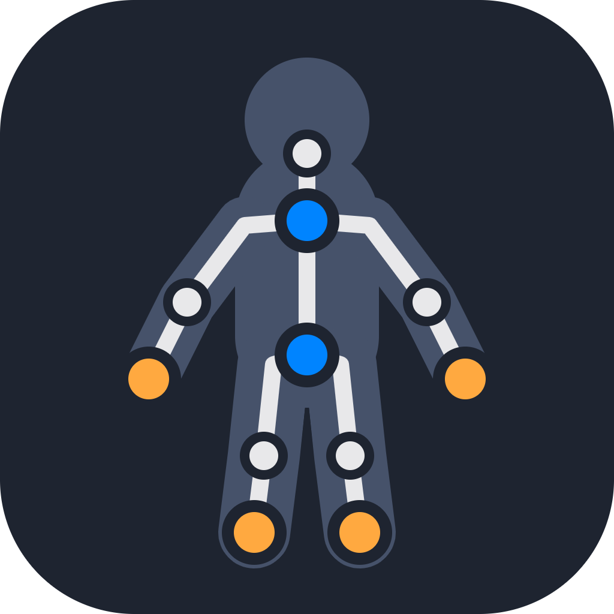
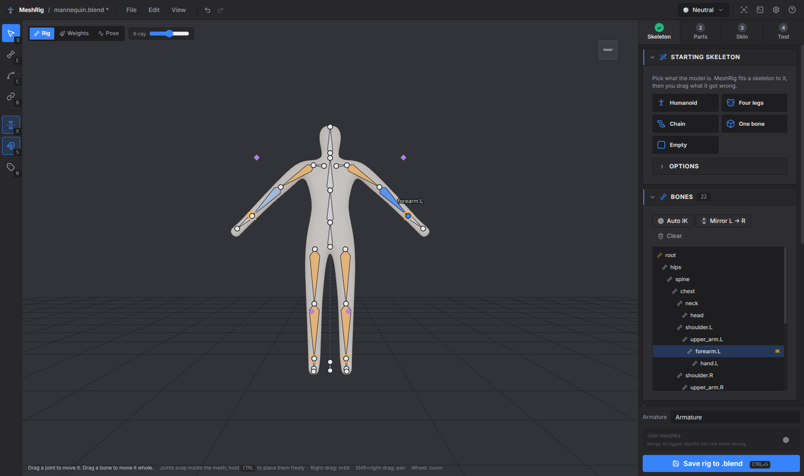
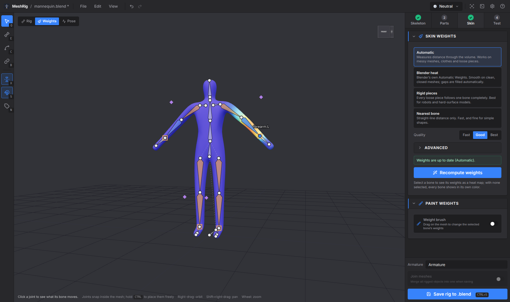
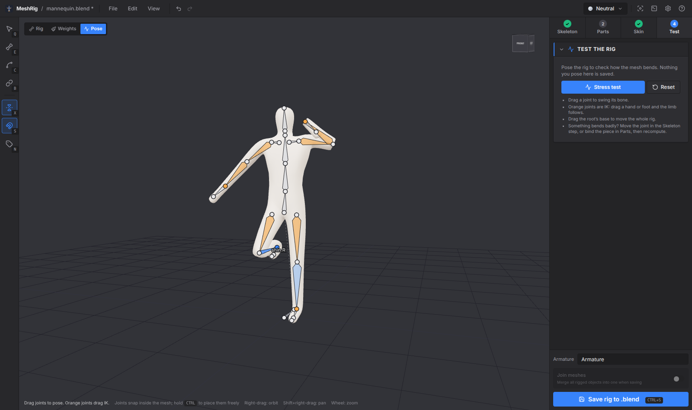
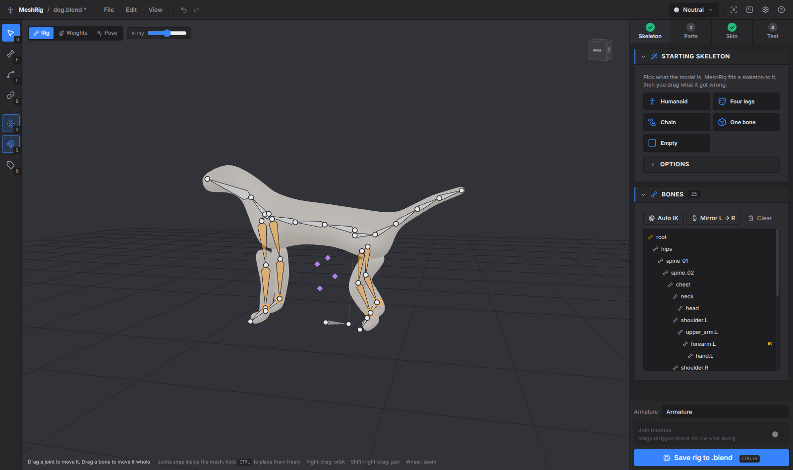

<p align="center">
  
</p>

<h1 align="center">MeshRig</h1>

<p align="center">
  <strong>Rig any mesh in a .blend in minutes: skeleton, skin weights and IK.</strong>
</p>

<p align="center">
  <a href="https://github.com/stuyk/meshrig/releases">
    
  </a>
  <a href="LICENSE">
    
  </a>
</p>

Open a `.blend`, pick a starting skeleton, drag what it got wrong, skin it, test it and save it. MeshRig writes a normal Blender armature with vertex groups, an Armature modifier and IK, so the rig works anywhere a Blender rig does.

<p align="center">
  
  
</p>
<p align="center">
  
  
</p>

## How it works

The sidebar has four steps. You can go back to any of them, and everything can be undone.

1. **Skeleton.** Pick Humanoid, Four legs, Chain or One bone. MeshRig reads the model's outline to find the crotch, neck, hands and legs, then centres every joint inside the mesh. Drag what's off. With symmetry on, the other side follows.
2. **Parts.** For models made of pieces (armour, props, robots): select a bone and click the pieces it should carry. Or let MeshRig give every object, or every loose piece, a bone of its own. The bones are chained by which pieces touch.
3. **Skin.** Compute the weights, then check them as a heat map and fix any problems with the weight brush.
4. **Test.** Pose the skinned rig by dragging hands and feet, or run the stress test, which bends every joint in turn.

Then **Save rig to .blend**.

## Features

- **Joints snap inside the mesh.** When you click or drag on the model, the joint goes to the middle of the limb under the cursor, not onto its surface. Hold Ctrl to place it freely. In front, side and top views a dragged joint keeps its depth, so it stays on axis; hold Ctrl there to centre it inside the mesh.
- **Flat views and snapping.** Front, side and top views (Numpad 1/3/7) go flat (orthographic) with a grid, so bones line up exactly; orbiting goes back to perspective, and Numpad 5 switches by hand. The Snap menu snaps joints to other joints, to the grid (automatic or fixed size), or turns bones in angle steps. Hold Shift while dragging to place freely.
- **See what's attached.** Press P (or the Pieces button) to colour every attached piece by its bone. Hover or select a bone and its pieces light up while the rest go dark. The bone list shows a 🔗 count per bone, and the Bone panel lists its pieces with Select and Detach.
- **Join pieces.** Shift+click pieces in the Parts list or the viewport and press Join (Ctrl+J). They merge into the biggest object, optionally welding touching vertices so they bend as one surface. Your .blend only changes when you save the rig, and Ctrl+Z separates them again.
- **Build your own.** The Add bone tool (E) extends the selected bone with each click; Shift+click starts a bone that hangs off the selected bone without touching it (shown with a dotted line, like Blender's disconnected children). D connects or disconnects any bone from its parent. The Draw chain tool (C) turns a stroke along a tail, tentacle or rope into a chain of bones.
- **Skinning that copes with real meshes.** The Automatic method measures distance through the model's volume, not through the air, so an arm doesn't pull the hip beside it. It works on open meshes, overlapping clothes and loose pieces. You can also use Blender's own bone heat (MeshRig fills any gaps it leaves), rigid pieces, or nearest bone.
- **Weight brush.** Add, subtract or smooth the selected bone's weights. Symmetry paints both sides.
- **Small pieces stay rigid.** Eyes, buttons and teeth follow one bone instead of stretching.
- **IK that just works.** Arms and legs get IK targets and poles, and Auto IK finds limbs that reach the ground. MeshRig works out which way knees and elbows bend, rolls the bones to match, and calibrates each pole angle in Blender so the rest pose doesn't move.
- **Reopens exactly.** MeshRig stores its skeleton on the armature, so opening the file again picks up where you left off. Rigs made elsewhere open too: their IK becomes MeshRig IK settings.
- **Advanced options when you want them.** Spine, neck, tail and finger counts; bone kind, parent, deform and roll per bone; IK chain length and pole direction; voxel resolution, falloff, smoothing and bones per vertex.

## Saving

- Before each save, the `.blend` is copied to `.meshrig-backups/` next to it. The last 20 copies are kept.
- MeshRig makes one armature (or rebuilds the one it opened) with **Deform** and **Controls** bone collections. Every rigged mesh gets vertex groups and an Armature modifier, and is parented to the armature. The modifier goes after any Mirror modifier and before Subdivision.
- IK targets (`hand_ik.L`) and poles (`forearm_pole.L`) are generated for every IK chain. Hands and feet copy the IK target's rotation.
- *Join meshes* merges all rigged objects into one when saving.

## Requirements

- [Blender](https://www.blender.org/download/), tested with 5.2. MeshRig runs it in the background to read and write `.blend` files and for Blender heat weights. It finds Blender on its own, or you can set the path in Preferences.
- Models should stand on the ground facing −Y (Blender's front view). The automatic fits use that to tell front from back.

## Keys

| Key | Action |
| --- | --- |
| 1 / 2 / 3 / 4 | Skeleton / Parts / Skin / Test |
| Q / E / C / B | Select, Add bone, Draw chain, Bind pieces |
| Shift+click | Start a new chain (Add bone) |
| X | Symmetry on / off |
| S | Snap inside the mesh on / off (hold Ctrl to switch it for one drag; front/side/top drags keep depth unless Ctrl is held) |
| N | Bone names |
| P | Colour pieces by the bone they're attached to |
| Shift+click | Select several pieces (Parts) |
| Ctrl+J | Join the selected pieces |
| D | Connect / disconnect the selected bone from its parent |
| Del | Delete bone |
| Num 1 / 3 / 7 | Front / side / top view (Ctrl: opposite side) |
| Num 5 or 5 | Flat / perspective view |
| G / A / J | Grid / angle / joint snapping on or off |
| Shift+drag | Place a joint without snapping |
| F | Frame the model or the selected bone |
| Ctrl+Z / Ctrl+Shift+Z | Undo / redo |
| Ctrl+S | Save into the .blend |

Press `?` in the app for the full list.

## Building from source

```bash
bun install        # or npm install
bun run dev        # run with hot reload
bun run test       # unit tests
bun run build:linux   # or build:win / build:mac
```

Built with Electron, Solid, three.js and three-mesh-bvh. The Blender scripts are in `resources/blender/`: `meshrig_load.py` reads a `.blend`, `meshrig_save.py` writes the rig, and `meshrig_heat.py` computes Blender's bone heat. The app is in `src/`: the rig model, fitting, skinning and IK are in `src/renderer/src/rig/`, and the viewport is in `src/renderer/src/viewport/`.

If you run Electron from a VS Code terminal, unset `ELECTRON_RUN_AS_NODE` first, or Electron starts as plain Node.

## Translations

All app text is in [src/shared/i18n/en.ts](src/shared/i18n/en.ts). To add a language, copy that file (for example to `de.ts`), translate the values, and add it to `dictionaries` in [src/shared/i18n/index.ts](src/shared/i18n/index.ts).

## License

GPL-3.0-or-later. See [LICENSE](LICENSE).
